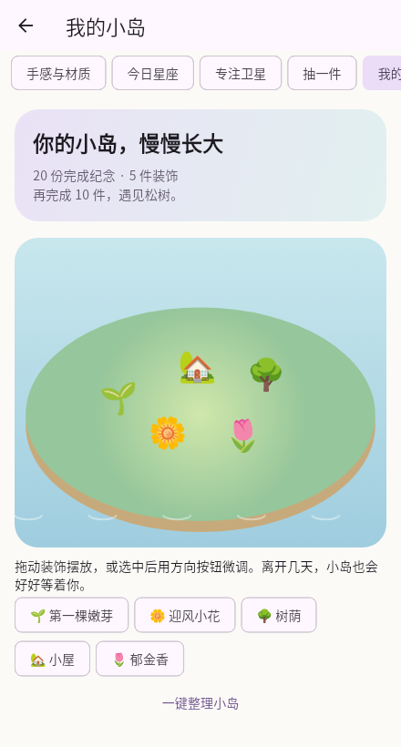

# 小事星球 · Small Orbit

把待办变成轻轻漂浮的泡泡，做完一件，就消掉一颗。

一个面向个人工作和生活的 **Windows / Android 离线待办工具**。默认泡泡，也可以切换纸片和卡牌；不用注册，没有云端依赖，用轻巧的完成反馈整理每天的小事。

**[下载 v1.0.0-rc.7](https://github.com/11234201/small_orbit/releases/tag/v1.0.0-rc.7)** · [使用说明](docs/user_guide.md) · [版本记录](docs/changelog.md) · [反馈问题](https://github.com/11234201/small_orbit/issues)

当前源码已加入 **rc.10 六种玩法候选版**：引力小星系、泡泡材质、今日星座、专注卫星、条件扭蛋和生长小岛，并包含仅背景透明、全局慢漂和拖拽惯性。下方公开 rc.7 下载包尚不包含这些改动；本地安装包与验证边界见[rc.10 候选说明](docs/releases/v1.0.0-rc.10.md)，新玩法与格式 2 升级说明见[使用说明](docs/user_guide.md)，实现范围见[玩法计划](docs/fun_features_plan.md)。

<p>
  
  
  
</p>

以上为实际 Flutter 渲染，使用示例任务；设备上的后台通知与触觉仍需真机验收。

## 看起来是什么样

<p>
  
  
</p>

左侧是完整界面，右侧是适合放在桌面一角的简洁模式。以上为实际 Flutter 渲染的示例界面，采用测试任务；原生窗口外框随系统而异。[查看泡泡运动预览](docs/preview/bubble_refresh/bubbles_motion.gif)。

## 能做什么

- **三种展示**：泡泡消除、纸片收纳、卡牌划走，共用同一份任务和撤销记录。
- **大小表达优先级**：重要程度与紧急程度共同决定泡泡大小；长标题保留全文，泡泡内最多显示两行。
- **可选运动节奏**：开场后安静、持续轻漂、持续活泼，也可以暂停或减少动态。可见但失焦的窗口继续运动，最小化或收进托盘后暂停。
- **日常待办**：快速添加、日期、提醒、每日/每周重复、搜索概览、完成历史与撤销。漏做的旧周期记入历史，当前不堆积多条。
- **Windows 小窗口**：仅显示待办、窗口置顶、背景透明度、拖动缩放、托盘收起；窗口偏好会在本机记住。公开 rc.7 使用整窗透明度，rc.8 改为只调整背景。
- **离线备份**：导出 `.orbit` 文件，在另一设备手动整份恢复；替换前自动备份。没有自动同步或跨设备合并。

## 下载与安装

当前发布 **1.0.0-rc.7+9**，标记为 **Pre-release（候选版）**。

| 平台 | 下载 | 使用方法 |
| --- | --- | --- |
| Windows 10/11 x64 | [Windows 便携 ZIP](https://github.com/11234201/small_orbit/releases/download/v1.0.0-rc.7/small_orbit-1.0.0-rc.7-windows-x64.zip) | 解压整个文件夹，运行 `small_orbit.exe`；保留 DLL 和 `data` 目录 |
| Android 8.0+，ARM64 | [Android ARM64 APK](https://github.com/11234201/small_orbit/releases/download/v1.0.0-rc.7/small_orbit-1.0.0-rc.7-android-arm64.apk) | 适合常见 ARM64 手机，包更小；用系统安装器安装 |
| Android 8.0+，其他架构 | [Android 通用 APK](https://github.com/11234201/small_orbit/releases/download/v1.0.0-rc.7/small_orbit-1.0.0-rc.7-android.apk) | 包含 ARM64、ARMv7、x86_64；不确定架构时选此包 |

[所有发布版本](https://github.com/11234201/small_orbit/releases) · [SHA-256 校验清单](https://github.com/11234201/small_orbit/releases/download/v1.0.0-rc.7/SHA256SUMS-1.0.0-rc.7.txt)

Windows 包包含所需的 Visual C++ 运行库，使用时不需要安装 Flutter。Android 首次设置提醒时需要允许系统通知；准时提醒的授权可在设置中检查。

**升级**：Windows 先从旧版托盘菜单选择“退出”，再打开新版目录；直接点关闭会收进托盘。Android 使用相同签名的 APK 覆盖安装，先导出备份，不要先卸载。两个平台的数据都独立保存在本机。

## 放在桌面一角

1. 在完整界面选择“一直轻轻漂浮”或“一直活泼弹跳”。
2. 右上角“窗口选项”勾选“仅显示待办”和“窗口置顶”。两个开关可以分别使用。
3. 拖动顶部细条移动，拖动窗口边缘缩放。右上角 `⋯` 可添加、撤销、收起和退出。
4. 在待办界面按 `Esc`，或选择“恢复完整界面”，重新显示全部控件。

右上角“窗口选项 → 窗口透明度”可调节整个窗口的不透明度（30%～100%），松开滑块后生效并记住。100%完全不透明；面板或托盘菜单可一键恢复。[调节面板预览](docs/preview/window_modes/opacity_panel.png)。

`Ctrl+N` 添加，`Ctrl+Z` 撤销最近任务操作；输入框内的 `Ctrl+Z` 保留文本撤销行为。

## 当前验证与使用边界

rc.7 已通过 **122 项 Flutter 回归**和 **16 项 Windows 原生窗口检查**，静态分析无问题；两端发布构建及安装包完整性检查通过。Android 通用与 ARM64 包沿用同一签名，不申请 INTERNET 权限。

Android 15 厂商后台提醒、Windows 10/11 完整桌面交互、多屏/系统通知、真机覆盖升级和连续使用仍需继续验收，因此当前保持候选版。Windows 明确退出后不会提醒；Android 系统“强制停止”后需重新打开，系统省电或通知设置也可能影响送达。具体证据见 [验证记录](docs/validation.md) 和 [设备验收清单](docs/device_acceptance.md)。

数据采用本地明文存储，备份格式为 1；没有账号、在线同步、协作或订阅服务。导入为整份替换，不能当作双向同步。

## 从源码运行

项目使用 Flutter，应用位于 `src/small_orbit/`。发布时使用 Flutter **3.47.9** / Dart **3.13.7**，依赖由 `pubspec.lock` 固定。

```sh
git clone https://github.com/11234201/small_orbit.git
cd small_orbit/src/small_orbit
flutter pub get
flutter analyze
flutter test --timeout 120s
```

Windows 开发环境需安装 Visual Studio 的 C++ 桌面开发工具和 Windows SDK，参见 [Flutter Windows 环境说明](https://docs.flutter.dev/platform-integration/windows/setup)。在 Windows 上运行：

```sh
flutter run -d windows
```

Android 准备 Android SDK、JDK 17，并连接设备或模拟器后运行 `flutter run -d <设备ID>`。本地开发签名与公开 APK 的发布签名不同。通用构建方法、维护者的固定环境及包校验步骤见 [构建说明](docs/build.md)。

## 项目结构与参与

| 路径 | 内容 |
| --- | --- |
| `src/small_orbit/lib/` | Flutter 界面、任务模型、本地存储与平台服务 |
| `src/small_orbit/windows/runner/` | Windows 托盘、提醒、窗口行为 |
| `src/small_orbit/android/` | Android 提醒、权限和生命周期集成 |
| `src/small_orbit/test/` | Flutter 回归与 Windows 原生检查 |
| `scripts/` | 构建、打包、校验与性能工具 |
| `docs/` | 使用说明、设计、验证记录和界面预览 |

安装包通过 GitHub Releases 分发；工具链、构建缓存、日志、个人任务数据和签名密钥不进入源码仓库。

欢迎通过 [Issues](https://github.com/11234201/small_orbit/issues) 反馈问题，附上版本、系统、复现步骤及预期结果；涉及截图或备份时请先去掉私人任务内容。开发方向见 [路线](docs/roadmap.md)，发布流程见 [Release 维护说明](docs/releasing.md)。

## 许可证

本项目采用 [MIT License](LICENSE)。Flutter、插件和运行库等第三方组件遵循各自的许可证；Windows 便携包保留 Flutter 依赖声明 `data/flutter_assets/NOTICES.Z`。
